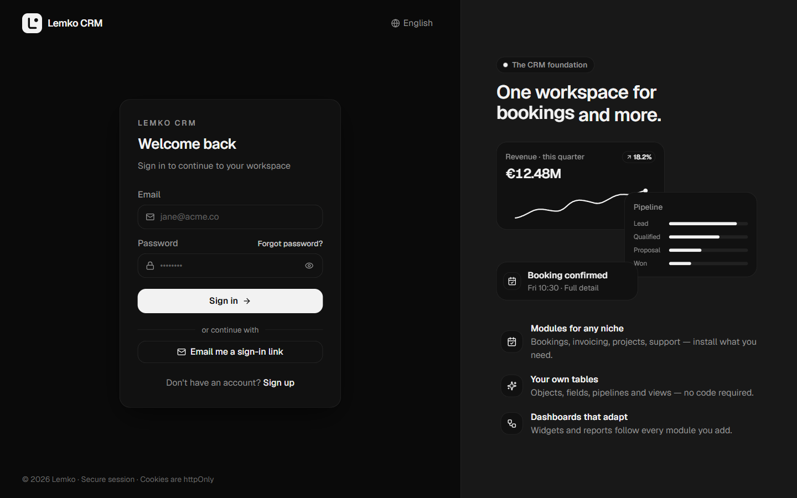
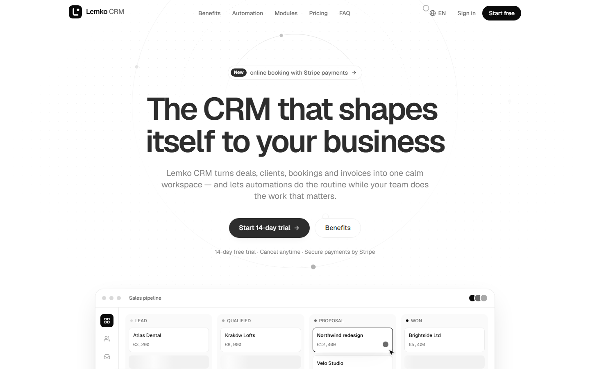

<div align="center">


# Lemko CRM — core edition

**Modularny, wielodostępowy (multi-tenant) CRM: FastAPI + PostgreSQL po stronie serwera, Next.js 16 po stronie interfejsu.**
Jeden rdzeń oparty na schematach, który dopasowuje się do dowolnej branży: szanse sprzedaży, kontakty, rezerwacje, faktury albo obiekty zdefiniowane przez samego użytkownika.

[](https://github.com/andreyermolenko25-boop/lemko-crm-showcase/actions/workflows/ci.yml)


[**Landing page online**](https://andreyermolenko25-boop.github.io/lemko-crm-showcase/) ·
[Uruchomienie CRM lokalnie](#uruchomienie-crm-lokalnie) ·
[Architektura (EN)](docs/ARCHITECTURE.md) ·
[English](README.md) ·
[По-русски](README.ru.md)

</div>


## O tym repozytorium

Lemko CRM to produkt, który samodzielnie projektuję i rozwijam. To repozytorium zawiera **wersję portfolio jego rdzenia**:
elementy pokazujące, jak system jest zbudowany — wielodostępowość, bezpieczeństwo, warstwę danych opartą na schematach,
analitykę i interfejs — wraz z działającym środowiskiem Docker, danymi demo i testami.

Część modułów produktu (silnik automatyzacji, wspólna skrzynka e-mail, rezerwacje online z płatnościami, formularze WWW,
wykrywanie duplikatów, import i migracja z innych CRM, generowanie dokumentów, studio modułów kodowych) oraz źródła
strony marketingowej **nie są publikowane**. [Landing page](https://andreyermolenko25-boop.github.io/lemko-crm-showcase/)
znajduje się tu wyłącznie jako skompilowana statyczna wersja w [`site-demo/`](site-demo).

## Co jest w środku

| | |
|---|---|
| **CRM oparty na schematach** | Każdy obiekt (szanse, kontakty, firmy, zadania, faktury, obiekty własne) jest opisany schematem. Listy, tablice kanban, kalendarze, karty rekordów, wyszukiwanie, raporty i widżety pulpitu działają automatycznie dla dowolnego obiektu — także tego, który użytkownik utworzy w interfejsie. |
| **Moduły** | Pakiety branżowe (rezerwacje i usługi, fakturowanie, magazyn, projekty, obsługa klienta, nieruchomości) to czysta konfiguracja: po instalacji ich obiekty pojawiają się w całym systemie. |
| **Hybrydowe przechowywanie** | Obiekty z regułami biznesowymi mają własne tabele (klienci z unikalnym telefonem, wizyty, które nie mogą się nakładać, stany magazynowe z rozchodem). Reszta to rekordy JSONB — wszystko za jednym API `/records`. |
| **Analityka po stronie serwera** | Widżety KPI, trendów, lejków, rankingów, celów i podziałów są liczone w Pythonie dla wybranego okresu; przeglądarka tylko je wyświetla. |
| **Bezpieczeństwo** | Hasła argon2id, sesje po stronie serwera za ciasteczkiem httpOnly (JWT nigdy nie trafia do JavaScriptu), 2FA przez TOTP / SMS / passkeys z kodami zapasowymi, logowanie OAuth, ponowne uwierzytelnienie przy wrażliwych zmianach, rate limiting, polityka workspace'u (wymuszone 2FA, lista dozwolonych IP, limit czasu sesji), CSP z nonce dla każdego żądania. |
| **API integracji** | Klucze API (haszowane, pokazywane raz, odwoływalne) do zewnętrznego REST API; webhooki podpisywane HMAC, sekrety szyfrowane AES-GCM, dostarczane przez workera z transakcyjnego outboxa z ponowieniami i wykładniczym back-offem; wychodzące żądania chronione przed SSRF. |
| **Integralność danych** | Izolacja tenantów na podstawie podpisanego tokenu, dziennik audytu tylko do dopisywania (wymuszony triggerem), miękkie usuwanie z przywracaniem, ograniczenia wykluczające PostgreSQL i triggery, dzięki którym dwie rezerwacje nigdy nie zajmą tego samego terminu — nawet przy współbieżności. |
| **UX** | Motywy jasny/ciemny, kolory akcentu, gęstość i rozmiar tekstu, paleta poleceń ⌘K, pulpity drag-and-drop, edycja w miejscu, pięć języków interfejsu (EN, PL, DE, UK, RU) z regionalnymi formatami liczb, walut i dat. |

### Kilka rzeczy wartych bliższego spojrzenia

- **Rezerwacje odporne na współbieżność.** `tests/test_core_e2e.py` wysyła 50 równoległych żądań na ten sam termin:
  wygrywa dokładnie jedno, pozostałe 49 dostaje `409`. Ograniczenie wykluczające GiST, blokady wierszy i dwa triggery
  ([migracja](alembic/versions)) pilnują, by wizyty mieściły się w zmianach pracowników, a zmiany nie „kurczyły się" pod wizytami.
- **Token nigdy nie trafia do przeglądarki.** BFF w Next.js (`frontend/app/api/*`) wymienia dane logowania na sesję po stronie
  serwera i przekazuje wywołania `/api/backend/*` z tokenem bearer; sesje można przeglądać i odwoływać z poziomu interfejsu.
- **Outbox + worker.** Zdarzenia zapisują się w tej samej transakcji co zmiana (`outbox.py`); `worker.py` pobiera wiersze
  przez `FOR UPDATE SKIP LOCKED`, podpisuje payloady webhooków i ponawia je z back-offem.
- **Jedna ścieżka każdego zapisu.** Interfejs, zewnętrzne API i seeder danych demo przechodzą przez
  `records.create_record` → `events.record_changed` → oś aktywności, powiadomienia, webhooki.

## Zrzuty ekranu

| Tablica szans | Karta rekordu z osią czasu |
|---|---|
|  |  |
| **Katalog modułów** | **Bezpieczeństwo i logowanie** |
|  |  |
| **Logowanie** | **Landing page (wersja statyczna)** |
|  |  |

## Uruchomienie CRM lokalnie

Wymagania: **Docker Desktop** (lub Docker Engine z Compose v2) oraz **Git**. Nic więcej nie trzeba instalować.

```bash
git clone https://github.com/andreyermolenko25-boop/lemko-crm-showcase.git
cd lemko-crm-showcase
docker compose up --build -d
```

Pierwsze budowanie trwa kilka minut. Gdy `docker compose ps` pokaże usługi jako healthy, załaduj dane demo:

```bash
docker compose exec backend python scripts/seed_demo.py
```

Następnie otwórz **http://localhost:3000** i zaloguj się:

| E-mail | Hasło |
|---|---|
| `demo@lemko.dev` | `lemko-demo-2026` |

Seeder tworzy fikcyjną firmę z trzema członkami zespołu, sześcioma firmami-klientami, ośmioma kontaktami,
dwunastoma szansami na różnych etapach i sześcioma zadaniami. Możesz też zarejestrować nowy workspace pod `/register`.

| Adres | Co |
|---|---|
| http://localhost:3000 | CRM (Next.js) |
| http://localhost:8000/docs | Dokumentacja API (Swagger UI) |
| `localhost:5432` | PostgreSQL (`lemko_admin` / `change_me`) |

<details>
<summary><b>Porty są już zajęte?</b></summary>

Każdy opublikowany port można zmienić zmienną środowiskową:

```bash
WEB_PORT=3300 API_PORT=8100 DB_PORT=5433 PUBLIC_APP_URL=http://localhost:3300 docker compose up --build -d
```

W Windows PowerShell najpierw ustaw zmienne: `$env:WEB_PORT=3300; $env:API_PORT=8100; $env:DB_PORT=5433; $env:PUBLIC_APP_URL="http://localhost:3300"`.
</details>

<details>
<summary><b>Co warto wypróbować</b></summary>

- Przeciągnij szansę przez lejek albo otwórz ją i kliknij etap — oś aktywności i pulpit zaktualizują się.
- **Customize** pulpitu: dodawaj widżety, zmieniaj ich rozmiar i kolejność.
- **Settings → Objects & fields**: dodaj pole lub cały nowy obiekt — od razu dostaje widok listy, tablicy i kalendarza.
- **Apps**: zainstaluj moduł *Projects* lub *Support Desk*.
- **Settings → Security & login**: skonfiguruj aplikację uwierzytelniającą (zeskanuj kod QR dowolną aplikacją TOTP) i zaloguj się ponownie.
  E-maile i kody SMS w tej konfiguracji lokalnej trafiają do logu workera: `docker compose logs -f worker`.
- **Settings → API & webhooks**: utwórz klucz API i wywołaj zewnętrzne API:
  `curl -H "X-API-Key: <klucz>" http://localhost:8000/api/v1/external/clients`
- Zmień język interfejsu (menu użytkownika) lub motyw (ikona księżyca na górnym pasku).
</details>

Zatrzymanie wszystkiego: `docker compose down` (z `-v` usuwa także bazę danych).

## Uruchomienie landing page'a lokalnie

Strona marketingowa jest publikowana wyłącznie jako statyczny build (HTML, CSS i zminifikowany JS — bez źródeł).
Działa online pod adresem **https://andreyermolenko25-boop.github.io/lemko-crm-showcase/** lub lokalnie:

```bash
npx serve site-demo
```

Otwórz wypisany adres (domyślnie http://localhost:3000; jeśli CRM już zajmuje port 3000, użyj `npx serve site-demo -l 3200`).
Wymaga Node.js 18+. W tym buildzie płatności są wyłączone.

## Testy

Testy backendu działają na prawdziwym PostgreSQL (ograniczeń wykluczających i JSONB nie da się przetestować na SQLite):

```bash
docker compose --profile test run --rm tests
```

Testy obejmują: generyczne API rekordów i oś aktywności, obiekty natywne (kontakty, usługi, magazyn),
zmiany i wizyty z wykrywaniem konfliktów, wyścig 50 żądań o jeden termin, formuły analityczne,
członków zespołu i wzmianki, kody błędów, logowanie, sesje i ich odwoływanie, dwuetapowe logowanie TOTP, re-auth,
reset hasła, zmianę e-maila, politykę bezpieczeństwa workspace'u, klucze API, ochronę webhooków przed SSRF i szyfrowanie sekretów.

Kontrole frontendu:

```bash
cd frontend
pnpm install
pnpm typecheck
pnpm build
```

Oba zestawy uruchamiają się w [GitHub Actions](.github/workflows/ci.yml) przy każdym pushu, razem z
`alembic upgrade head` + `alembic check` na pustej bazie.

## Uruchomienie bez Dockera

<details>
<summary>Backend (Python 3.12) i frontend (Node 22, pnpm 9)</summary>

```bash
# tylko baza danych
docker compose up -d db

# API
python -m venv .venv && source .venv/bin/activate   # Windows: .venv\Scripts\activate
pip install -r requirements-dev.txt
cp .env.example .env            # do pracy lokalnej ustaw POSTGRES_SSLMODE=disable i DEBUG=true
alembic upgrade head
uvicorn main:app --reload       # http://localhost:8000/docs
python worker.py                # drugi terminal: outbox, przypomnienia, podsumowania

# interfejs
cd frontend
cp .env.example .env.local      # API_URL=http://localhost:8000
pnpm install && pnpm dev        # http://localhost:3000
```
</details>

## Stos technologiczny

| Warstwa | Technologia |
|---|---|
| API | Python 3.12, FastAPI, Pydantic v2, SQLAlchemy 2.0, Alembic |
| Baza danych | PostgreSQL 15 (JSONB, ograniczenia wykluczające GiST, triggery ograniczeń) |
| Bezpieczeństwo | argon2id (passlib), PyJWT, passkeys WebAuthn, TOTP (RFC 6238), AES-GCM przez `cryptography` |
| Zadania w tle | Transakcyjny outbox + worker (`FOR UPDATE SKIP LOCKED`), adaptery SMTP / AWS SNS / Twilio |
| Pliki | Dysk lokalny lub zgodny z S3 (MinIO, AWS S3) dla załączników |
| Frontend | Next.js 16 (App Router, Turbopack), React 19, TypeScript, Tailwind CSS v4, Radix UI, Recharts, Motion |
| Narzędzia | Docker Compose, pytest + httpx, GitHub Actions |

## Struktura projektu

```
main.py              aplikacja FastAPI: główne endpointy REST (firmy, personel, klienci, usługi, magazyn, zmiany, wizyty, płatności)
routers/             auth, bezpieczeństwo i sesje, rekordy, workspace, aktywności, analityka, członkowie, integracje, API zewnętrzne
core/                konfiguracja, baza, auth (sesje, MFA, OAuth, polityki), bezpieczeństwo, kryptografia, rate limit, ochrona SSRF, middleware
records.py           jedno API rekordów nad tabelami natywnymi i generycznymi rekordami JSONB
scheduling.py        zmiany i wizyty: reguły nakładania się i pokrycia zmianą
stats.py             formuły po stronie serwera dla widżetów i raportów
events.py            co dzieje się po zmianie: oś aktywności, powiadomienia, webhooki
outbox.py, worker.py niezawodne dostarczanie webhooków, e-maili i SMS
alembic/             migracja schematu (w tym ręcznie pisane triggery ograniczeń)
scripts/             seeder danych demo
tests/               zestaw pytest (PostgreSQL)
frontend/            aplikacja Next.js — zob. frontend/README.md
site-demo/           skompilowany landing page (eksport statyczny)
docs/                notatki o architekturze i zrzuty ekranu
```

Więcej o decyzjach projektowych: **[docs/ARCHITECTURE.md](docs/ARCHITECTURE.md)** (po angielsku).

## Licencja

Copyright © 2026 Andrii Yermolenko. **Wszelkie prawa zastrzeżone.**
Kod jest opublikowany, aby można go było czytać i oceniać (na przykład w procesie rekrutacji) — zob. [LICENSE](LICENSE).
Nie wolno go kopiować, ponownie wykorzystywać ani wdrażać jako produktu lub usługi bez pisemnej zgody.

---

Autor: **Andrii Yermolenko** · [github.com/andreyermolenko25-boop](https://github.com/andreyermolenko25-boop)
