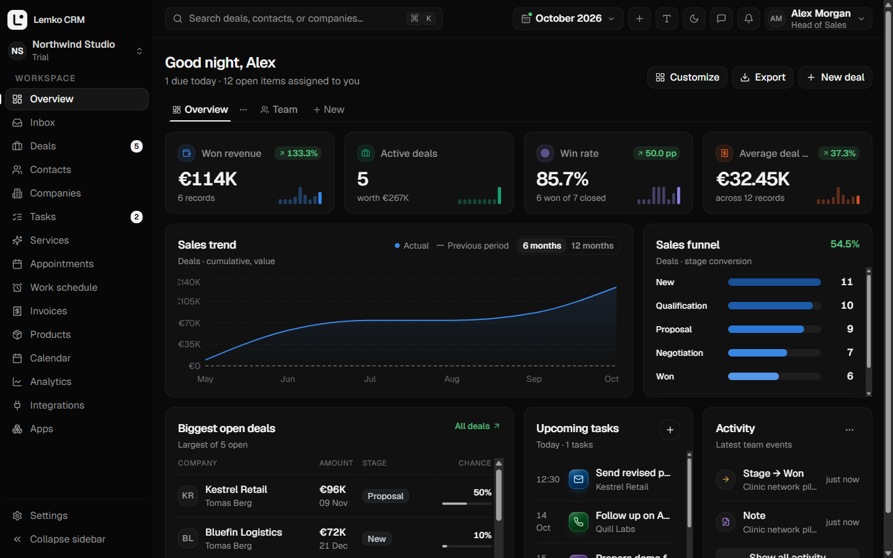
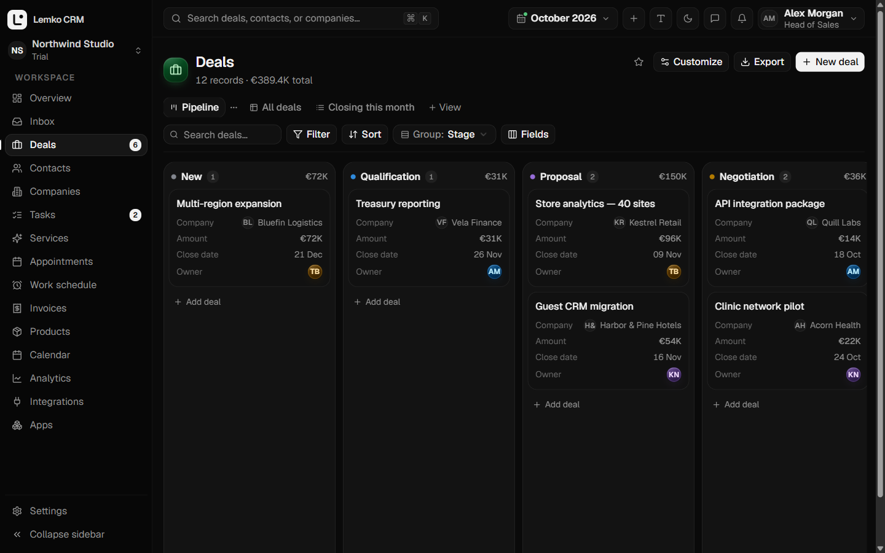
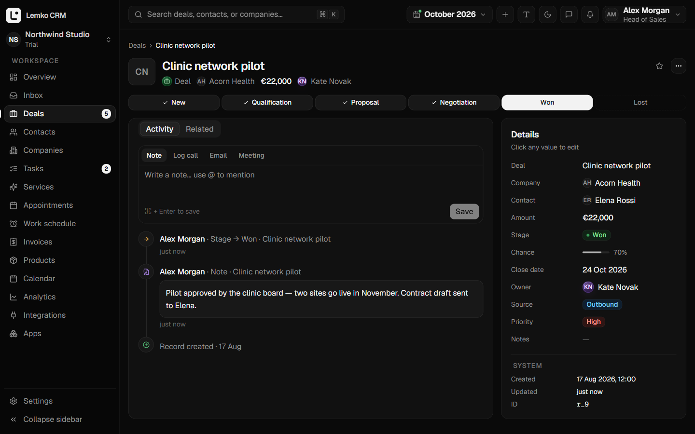
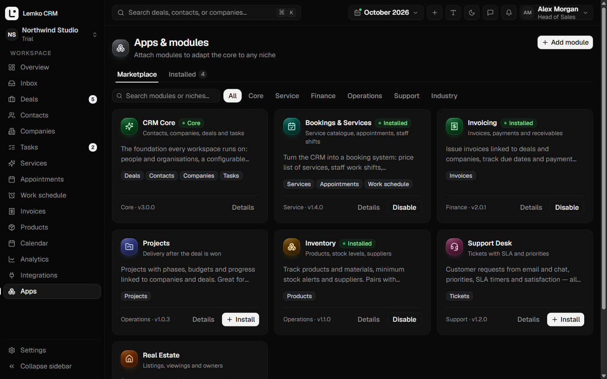
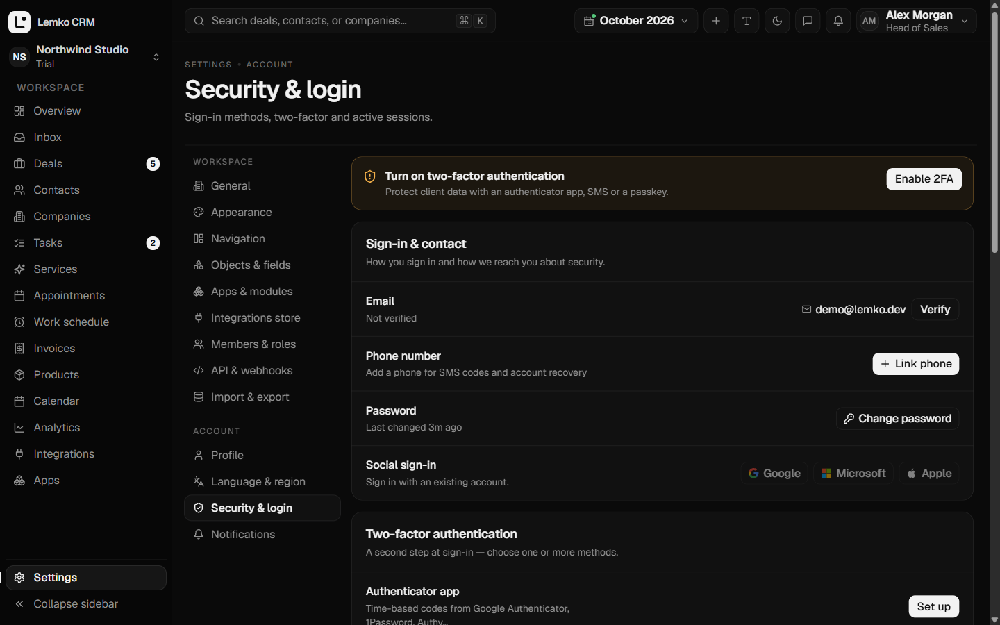

<div align="center">


# Lemko CRM — core edition

**Модульная мультитенантная CRM: FastAPI + PostgreSQL на бэкенде, Next.js 16 на фронтенде.**
Одно ядро на схемах, которое подстраивается под любую нишу: сделки, контакты, записи, счета или объекты, созданные самим пользователем.

[**Лендинг онлайн**](https://andreyermolenko25-boop.github.io/lemko-crm-showcase/) ·
[Запуск CRM локально](#запуск-crm-локально) ·
[Архитектура (EN)](docs/ARCHITECTURE.md) ·
[English](README.md)

</div>



## Об этом репозитории

Lemko CRM — продукт, который я проектирую и разрабатываю самостоятельно. Здесь опубликована **портфолио-версия
его ядра**: то, что показывает инженерную сторону — мультитенантность, безопасность, слой данных на схемах,
аналитику и интерфейс, — с рабочим Docker-окружением, демо-данными и тестами.

Часть модулей продукта (движок автоматизаций, общий почтовый inbox, онлайн-запись с оплатой, веб-формы, поиск
дублей, импорт и миграция из других CRM, генерация документов, студия кодовых модулей) и исходники маркетингового
сайта **не публикуются**. [Лендинг](https://andreyermolenko25-boop.github.io/lemko-crm-showcase/) лежит только в
виде собранной статики в [`site-demo/`](site-demo).

## Что внутри

- **CRM на схемах.** Любой объект (сделки, контакты, компании, задачи, счета, собственные объекты) описан схемой.
  Списки, канбан, календарь, карточка, поиск, отчёты и виджеты работают для любого объекта автоматически.
- **Модули.** Нишевые пакеты (услуги и запись, счета, склад, проекты, поддержка, недвижимость) — чистая конфигурация.
- **Гибридное хранение.** Объекты с бизнес-правилами живут в своих таблицах (уникальный телефон клиента, визиты без
  пересечений, списание со склада), остальные — JSONB-записи. Всё за одним API `/records`.
- **Аналитика на сервере.** KPI, тренды, воронки, лидерборды, цели и разбивки считаются в Python за выбранный период.
- **Безопасность.** argon2id, серверные сессии за httpOnly-cookie (JWT не попадает в JavaScript), 2FA через TOTP /
  SMS / passkeys с резервными кодами, вход через OAuth, повторная аутентификация для чувствительных действий,
  rate limit, политика воркспейса (обязательная 2FA, IP-allowlist, таймаут сессии), CSP с nonce.
- **API и вебхуки.** API-ключи (хэш, показываются один раз, отзываются) для внешнего REST API; вебхуки с HMAC-подписью,
  секреты зашифрованы AES-GCM, доставка воркером из транзакционного outbox с ретраями; защита исходящих запросов от SSRF.
- **Целостность данных.** Изоляция тенанта по подписанному токену, журнал аудита только на запись (триггер),
  мягкое удаление с восстановлением, exclusion-ограничения и constraint-триггеры PostgreSQL против двойной записи.
- **UX.** Светлая и тёмная темы, акцентный цвет, плотность и размер текста, ⌘K, дашборды с drag-and-drop,
  инлайн-редактирование, пять языков интерфейса (EN, PL, DE, UK, RU) с региональными форматами.

Самое интересное для ревью — **запись без гонок**: `tests/test_core_e2e.py` отправляет 50 параллельных запросов
на один слот, успешен ровно один, остальные получают `409`.

## Скриншоты

| Канбан сделок | Карточка с лентой |
|---|---|
|  |  |
| **Каталог модулей** | **Безопасность и вход** |
|  |  |

## Запуск CRM локально

Нужны только **Docker Desktop** (или Docker Engine с Compose v2) и **Git**.

```bash
git clone https://github.com/andreyermolenko25-boop/lemko-crm-showcase.git
cd lemko-crm-showcase
docker compose up --build -d
```

Первая сборка занимает несколько минут. Когда `docker compose ps` покажет сервисы как healthy, загрузите демо-данные:

```bash
docker compose exec backend python scripts/seed_demo.py
```

Откройте **http://localhost:3000** и войдите:

| Email | Пароль |
|---|---|
| `demo@lemko.dev` | `lemko-demo-2026` |

Сид создаёт вымышленную компанию с тремя сотрудниками, 6 компаниями-клиентами, 8 контактами, 12 сделками на разных
стадиях и 6 задачами. Можно и зарегистрировать новый воркспейс на `/register`.

| Адрес | Что |
|---|---|
| http://localhost:3000 | CRM (Next.js) |
| http://localhost:8000/docs | Документация API (Swagger) |
| `localhost:5432` | PostgreSQL (`lemko_admin` / `change_me`) |

**Порты заняты?** Любой порт меняется переменной окружения:

```bash
WEB_PORT=3300 API_PORT=8100 DB_PORT=5433 PUBLIC_APP_URL=http://localhost:3300 docker compose up --build -d
```

В PowerShell: `$env:WEB_PORT=3300; $env:API_PORT=8100; $env:DB_PORT=5433; $env:PUBLIC_APP_URL="http://localhost:3300"`, затем `docker compose up --build -d`.

**Что попробовать:** перетащить сделку по воронке; настроить дашборд (**Customize**); добавить поле или целый объект в
**Settings → Objects & fields**; установить модуль в **Apps**; включить приложение-аутентификатор в
**Settings → Security & login** (письма и SMS-коды в локальном режиме пишутся в лог воркера:
`docker compose logs -f worker`); создать API-ключ и вызвать
`curl -H "X-API-Key: <ключ>" http://localhost:8000/api/v1/external/clients`.

Остановить: `docker compose down` (с `-v` — удалить и базу).

## Запуск лендинга локально

Сайт опубликован только как собранная статика (HTML, CSS и минифицированный JS, без исходников).
Он доступен онлайн: **https://andreyermolenko25-boop.github.io/lemko-crm-showcase/**, или локально:

```bash
npx serve site-demo
```

Откройте адрес из вывода (по умолчанию http://localhost:3000; если там уже CRM — `npx serve site-demo -l 3200`).
Нужен Node.js 18+. Оплата в этой сборке отключена.

## Тесты

```bash
docker compose --profile test run --rm tests     # 28 тестов бэкенда против настоящего PostgreSQL
cd frontend && pnpm install && pnpm typecheck && pnpm build
```

Всё это, плюс `alembic upgrade head` и `alembic check` на пустой базе, запускается в GitHub Actions на каждый push.

## Стек

Python 3.12, FastAPI, Pydantic v2, SQLAlchemy 2.0, Alembic · PostgreSQL 15 · argon2id, PyJWT, WebAuthn, TOTP, AES-GCM ·
Next.js 16, React 19, TypeScript, Tailwind CSS v4, Radix UI, Recharts, Motion · Docker Compose, pytest, GitHub Actions.

## Лицензия

© 2026 Andrii Yermolenko. **Все права защищены.** Код открыт для просмотра и оценки (например, при найме) —
см. [LICENSE](LICENSE). Копирование, повторное использование и развёртывание как продукта без письменного
разрешения запрещены.
