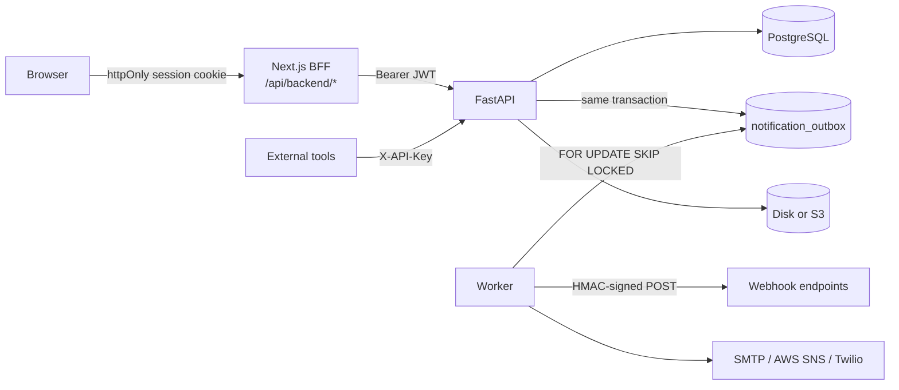

# Architecture

This document explains how the core of Lemko CRM is put together and why. It covers the code in this
repository (the core edition); product modules that are not published are only mentioned where an
extension point exists for them.

## Overview



| Process | Responsibility |
|---|---|
| **frontend** (Next.js 16) | UI, and a thin backend-for-frontend: it owns the session cookie and proxies API calls. The browser never talks to FastAPI directly. |
| **backend** (FastAPI) | Business rules, tenancy, security, analytics. Runs `alembic upgrade head` on start. |
| **worker** (`worker.py`) | Delivers the outbox (webhooks, e-mail, SMS), sends due-date reminders and weekly digests, prunes expired sessions and one-time codes. |
| **db** (PostgreSQL 15) | The only stateful service. Rate limits, sessions and the outbox live here too — no Redis or broker to operate. |

## Tenancy and authentication

- Every workspace is a `Company`; every tenant table carries `company_id` (`TenantMixin`).
- `core/deps.py` resolves the caller from the token (cookie `lemko_session` or `Authorization: Bearer`),
  then the company **from the token's claim**, and checks it against `company_id` in the URL. The tenant is
  never read from a request body.
- Access tokens are short-lived JWTs bound to a server-side `AuthSession` row. Sessions can be listed and
  revoked from the UI, expire after inactivity and after an absolute lifetime, and can be bound to the client IP.
- The Next.js routes in `frontend/app/api/*` perform sign-in, refresh and sign-out and keep the token in an
  httpOnly, SameSite cookie, so an XSS cannot read it. Pages are served with a nonce-based CSP.
- Passwords use argon2id (old bcrypt hashes are upgraded on sign-in). Two-factor options: TOTP (RFC 6238,
  secret encrypted at rest, replay protected), SMS codes, WebAuthn passkeys, single-use backup codes.
  Sensitive changes (password, e-mail, 2FA) require a recent re-authentication.
- A workspace policy can force 2FA, restrict sign-in to IP ranges, set the session timeout and the minimum
  password length.
- Rate limiting (`core/ratelimit.py`) is a fixed window in PostgreSQL, one atomic `INSERT … ON CONFLICT`
  per check, applied to sign-in, registration, code delivery and recovery.

## Data model: one record API, two kinds of storage

The UI is schema-driven: an object is an `EntityDef` (key, fields, which field is the stage, the date,
the amount, the owner). Modules are bundles of such definitions. The resolved definitions are pushed to
`PUT /workspace/schema` so the server can title feed events and compute widgets.

`records.py` exposes every object through one API — `GET/POST/PATCH/DELETE /companies/{id}/records/{entity}` —
with ids prefixed by their collection (`r_12`, `cl_3`, `ap_7`, `u_2`) so relations stay unambiguous:

| Objects | Storage | Why |
|---|---|---|
| contacts, services, products, appointments, shifts | Their own tables via adapters (`ContactsAdapter`, `AppointmentsAdapter`, …) | They carry rules a database should enforce: unique phone per workspace, stock that cannot go negative, appointments that cannot overlap and must fit a shift. |
| deals, companies, tasks, invoices, custom objects | `crm_records.data` (JSONB, GIN-indexed) | Shape is defined by the workspace; the server normalises values by field type. |

Fields that a native table does not have (tags, owner, custom fields) go into its `custom_fields` JSONB,
so a user can extend even the native objects.

## Scheduling under concurrency

Booking is where a CRM for service businesses usually breaks. Three layers make double booking impossible:

1. The application checks the slot and locks the staff member's shift rows (`SELECT … FOR UPDATE`).
2. `appointments` has a GiST **exclusion constraint** on `(user_id, tstzrange(starts_at, ends_at))` for
   non-cancelled rows; `work_shifts` has the same for shifts.
3. Two **constraint triggers** (in the migration) check, inside PostgreSQL, that an appointment lies within a
   shift and that a shift cannot be shortened or deleted while it still covers appointments.

`tests/test_core_e2e.py::test_appointment_race_condition_stress` sends 50 concurrent requests for one slot and
asserts that exactly one succeeds and 49 receive `409` with the conflicting appointment.

## After a change: events, feed, notifications, webhooks

Every write goes through the same path, whether it comes from the UI, the external API or a script:

```
records.create/update/delete_record
  └─ events.record_changed(ctx, change)          # same DB transaction
       ├─ activities.log_change                  # feed entry with structured params (localised in the UI)
       ├─ notifications.on_change                # personal notifications: assignment, @mentions
       └─ integrations.enqueue_record_webhooks   # one outbox row per subscribed webhook
```

The outbox row commits together with the change, so a webhook is never sent for a rolled-back write and is
never lost if the process dies. The worker claims pending rows with `FOR UPDATE SKIP LOCKED` (several workers
can run side by side), signs the body with HMAC-SHA256 (`X-Lemko-Signature`), and retries transient failures
with exponential back-off (30 s · 2ⁿ, capped at one hour). Codes and links in delivered security messages are
redacted from the outbox after delivery.

The unpublished automations module subscribes at the same point in `events.record_changed`.

## Analytics

Dashboard widgets and reports are computed on the server (`stats.py`) for the period chosen in the top bar —
KPIs with the change against the previous period, cumulative trends, stage funnels with conversion and median
cycle time, leaderboards, goals and breakdowns. A dashboard requests all its widgets in one call
(`POST /analytics/widgets`); each widget returns either data or a typed error, so one misconfigured widget does
not break the page.

## Integrations and outbound safety

- **API keys** — generated once (`lmk_…`), stored as an argon2id hash with a lookup prefix, scoped, revocable,
  optionally expiring. The external API under `/api/v1/external/*` accepts them via `X-API-Key`.
- **Webhooks** — per-event subscriptions; secrets are encrypted with AES-256-GCM (`core/crypto.py`,
  format `enc:v1:…`) and shown to the user only once.
- **SSRF guard** (`core/netguard.py`) — outbound URLs are resolved and rejected if they point to private,
  loopback, link-local or metadata addresses; redirects are not followed; credentials in URLs are refused.

## Audit, deletion and integrity

- `audit.py` hooks into the SQLAlchemy session and writes an `audit_logs` row (who, what, before/after) in the
  same transaction as every insert, update and delete of business tables. A trigger rejects any `UPDATE` of
  `audit_logs`, so the log is append-only.
- Users, clients, services, stock items and generic records are soft-deleted (`deleted_at`) and can be restored
  by owners and admins; history (visits, payments, feed) stays intact.
- Domain errors carry a stable machine code (`{"detail": {"code", "message", …}}`); the UI maps codes to texts
  in the member's language.

## Frontend

- **Stores** — small typed stores (`lib/core/store.ts`) for the session, workspace configuration, records and UI
  state. Edits are applied optimistically and rolled back with a toast if the API refuses them; creations wait
  for the server, because it assigns ids and runs side effects.
- **Views** — table, board, list, gallery and calendar, each saved per object with filters, sort, grouping and
  columns; every object gets them without object-specific code.
- **i18n** — five dictionaries typed against the English source (a missing key fails `tsc`), plural rules via
  `Intl.PluralRules`, regional formats (currency, dates, week start, units) independent of the interface language.
- **Appearance** — theme, accent colour, density, radius and text size are CSS variables, cached locally for the
  first paint and stored in the member's preferences.

## Decisions in brief

| Decision | Reason |
|---|---|
| PostgreSQL for rate limits, sessions and the queue | One stateful dependency for a small team to operate; the volumes involved are tiny for Postgres. |
| JSONB records next to real tables | Flexibility where the shape is user-defined, constraints where correctness matters. |
| BFF instead of tokens in the browser | Removes token theft via XSS from the threat model; the API stays a plain bearer-token API for other clients. |
| Server-side analytics | Numbers are identical for every member and device and do not depend on how many records the browser loaded. |
| Transactional outbox | Exactly the changes that committed produce side effects, with retries and no extra infrastructure. |
| Hand-written triggers in the migration | The guarantees hold even for code paths written later or for direct SQL. |
